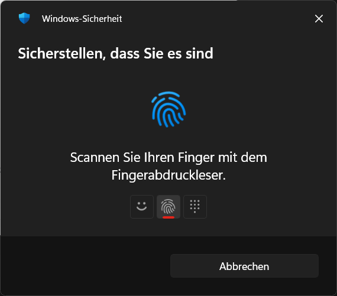
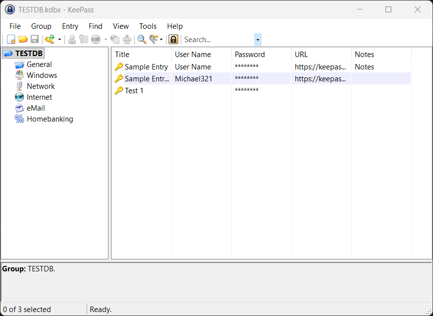
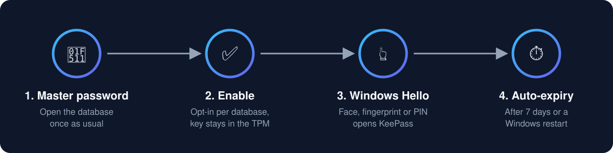

<div align="center">


# Miftawerk Unlock

### KeePass Windows Hello plugin – unlock KeePass 2 with your face or fingerprint

**English** · [Deutsch](translations/README.de.md) · [العربية](translations/README.ar.md) · [Français](translations/README.fr.md) · [Español](translations/README.es.md) · [Italiano](translations/README.it.md) · [Nederlands](translations/README.nl.md) · [Polski](translations/README.pl.md) · [Português](translations/README.pt-BR.md) · [Türkçe](translations/README.tr.md)

[](https://github.com/SeeColors/miftawerk-unlock/actions/workflows/build.yml)
[](LICENSE)


Free and open source · Made in Germany by **[SeeColors iT](https://seecolors.de)**

</div>

---

**Miftawerk Unlock** is a free, open-source plugin for **KeePass 2** (KeePass Password Safe)
that lets you **unlock your KeePass database with Windows Hello** – **face recognition,
fingerprint or Windows Hello PIN** – instead of typing the master password every time.
The Windows Hello key is held in the **TPM**, quick unlock **expires automatically**, and
KeePass is **locked when you lock Windows**.

> **Status: alpha.** Working on Windows 11 with face and fingerprint in our tests.
> Please use a test database until the first signed release.

## Features

| | |
|---|---|
| 🔓 **Windows Hello unlock** | Face, fingerprint or Windows Hello PIN at the KeePass master key prompt |
| 🔐 **TPM-backed key** | The Windows Hello key is created by Windows and stays in the TPM (where present) |
| ⏱️ **Automatic expiry** | Quick unlock ends after 7 days or at the next Windows restart |
| 🔒 **Locks with Windows** | KeePass locks on Win+L, session disconnect or sleep *(test pending)* |
| 🗂️ **Per database, opt-in** | You decide for each database; default is *No* |
| 💾 **Never writes your .kdbx** | Your database file is not modified by the plugin |
| 🛟 **Fail-safe** | Cancel or any error → the normal master password prompt |
| 🌍 **Any Windows language** | The Windows Hello dialog is brought to the front independent of language |
| 🚫 **No telemetry** | No network access, no data collection |

## Screenshots

| Windows Hello at the KeePass prompt | KeePass unlocked – no password typed |
|---|---|
|  |  |

## How it works



1. Open your database once with the master password as usual.
2. Miftawerk Unlock asks: *"Enable Windows Hello quick unlock for this database?"*
3. Next time KeePass asks for the master key, Windows Hello appears on top.
   Look at the camera or touch the fingerprint reader – the database opens.
4. After 7 days or a Windows restart, the master password is required again.

**Under the hood:** the plugin creates its own key with the Windows `KeyCredentialManager`
API. Windows signs a random challenge; from that signature the plugin derives a key
(HKDF-SHA256) that encrypts the database key material (AES-256-CBC + HMAC-SHA256),
additionally protected with Windows DPAPI and stored locally in
`%LOCALAPPDATA%\SeeColors\MiftawerkUnlock`. The plain master password is never stored.

## Frequently asked questions

**Can I unlock KeePass with my fingerprint or face?**
Yes, with a plugin. KeePass 2 has no built-in Windows Hello support. Miftawerk Unlock adds
Windows Hello (face, fingerprint, PIN) to the KeePass master key prompt.

**Does KeePass support Windows Hello natively?**
No. KeePass 2 supports master password, key file and Windows user account. Windows Hello
requires a plugin such as Miftawerk Unlock.

**Is Windows Hello a second factor for KeePass?**
No – and we say this openly. Windows Hello always accepts the Windows Hello PIN. Anyone who
knows your PIN and can use your Windows session can open an enabled database while quick
unlock is valid. It is a **convenience feature**. A YubiKey mode as a real second factor is planned.

**Does quick unlock survive a restart?**
No, by design. After a Windows restart or after 7 days you enter the master password again.

**Does the plugin see my biometric data?**
No. Face and fingerprint recognition happen entirely inside Windows Hello. According to
Microsoft, biometric data does not leave the device. The plugin only receives a signature.

**Does it work with KeePassXC?**
No. KeePassXC is a separate application with its own Windows Hello feature.
Miftawerk Unlock is a plugin for KeePass 2 (by Dominik Reichl).

**Why does Windows block the plugin ("Smart App Control")?**
Windows 11 Smart App Control blocks unsigned DLLs. Signed releases are planned
(see *Code signing policy*).

## Requirements

- Windows 10 or 11 with Windows Hello set up (face, fingerprint or PIN)
- KeePass 2.60 or newer, .NET Framework 4.8

## Privacy (GDPR / DSGVO)

- No biometric data reaches the plugin; recognition happens inside Windows Hello.
- No telemetry, no network connections, no accounts.
- All data stays on your PC, encrypted, under your Windows user.

## Security notes

- Windows Hello PIN fallback: see FAQ above.
- Malware running as your Windows user can read KeePass memory after any unlock;
  no quick-unlock method protects against that.
- Treat an unexpected Windows Hello prompt like an unexpected UAC prompt: cancel it.
- Report vulnerabilities privately: see [SECURITY.md](SECURITY.md).

## Roadmap

- [x] Windows Hello quick unlock with automatic expiry
- [ ] Lock KeePass when Windows locks (implemented, test pending)
- [ ] Signed releases (SignPath Foundation)
- [ ] Settings dialog, German and Arabic UI
- [ ] YubiKey challenge-response as a real second factor (KeePassXC-compatible format)
- [ ] Integration with the browser extension *Miftawerk Connect*

## Research behind the design

Before writing any code we analysed public user reports of existing KeePass Windows Hello
and YubiKey solutions and tested the Windows APIs on real hardware:
[research report](docs/research/report-windows-hello-keepass-plugins.md) ·
[experiment results](docs/research/phase0/02-experiment-results.md).
Miftawerk Unlock is written from scratch; no code was copied from other projects.

## Build from source

Requires the .NET SDK (no Visual Studio needed):

```
dotnet build src/MiftawerkUnlock/MiftawerkUnlock.csproj -c Release
```

The build references `KeePass.exe` from `testenv/KeePass/` (a portable KeePass copy that is
not part of this repository).

## Code signing policy

Planned: free code signing provided by [SignPath.io](https://about.signpath.io),
certificate by [SignPath Foundation](https://signpath.org). Only binaries built automatically
from this repository will be signed.

## About SeeColors iT

Miftawerk Unlock is developed and maintained by **[SeeColors iT](https://seecolors.de)**, Germany.
Questions, feedback or business inquiries: **support@seecolors.de**

⭐ If Miftawerk Unlock is useful to you, please star the repository – it helps others find it.

## License

MIT – see [LICENSE](LICENSE). © 2026 SeeColors iT.
KeePass is a project by Dominik Reichl. Miftawerk Unlock is an independent plugin and not
affiliated with the KeePass project. Windows Hello is a trademark of Microsoft.

<sub>Keywords: KeePass Windows Hello plugin, KeePass fingerprint unlock, KeePass face unlock,
KeePass biometric unlock, KeePass quick unlock, KeePass TPM, KeePass 2 plugin, Windows Hello
password manager, KeePass Fingerabdruck, KeePass Gesichtserkennung, KeePass Windows Hello entsperren.</sub>
