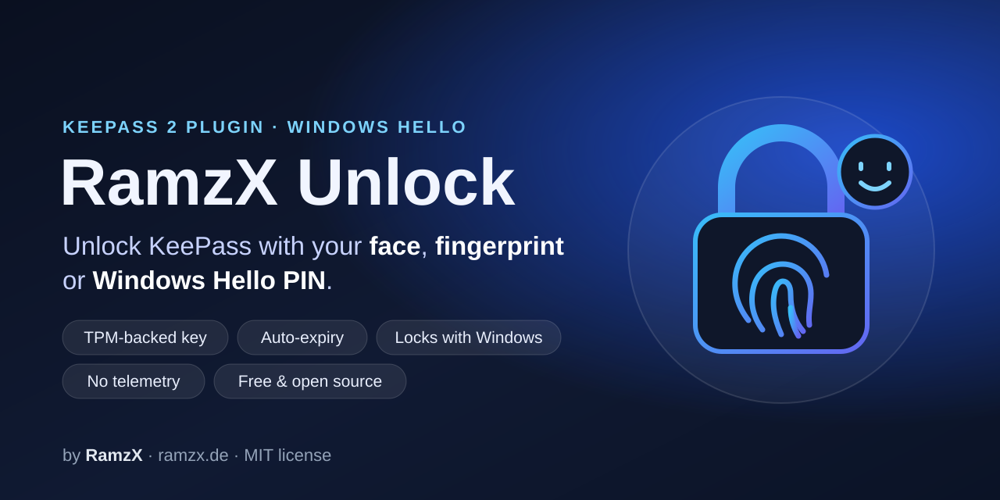

# Miftawerk Unlock

### Windows Hello-plugin voor KeePass – ontgrendel KeePass 2 met je gezicht of vingerafdruk

[English](../README.md) · [Deutsch](README.de.md) · [العربية](README.ar.md) · [Français](README.fr.md) · [Español](README.es.md) · [Italiano](README.it.md) · **Nederlands** · [Polski](README.pl.md) · [Português](README.pt-BR.md) · [Türkçe](README.tr.md)

Gratis en open source · Ontwikkeld door **[SeeColors iT](https://seecolors.de)**

---

**Miftawerk Unlock** is een gratis open-source plugin voor **KeePass 2** (KeePass Password Safe).
Hiermee **ontgrendel je je KeePass-database met Windows Hello** – **gezichtsherkenning,
vingerafdruk of Windows Hello-pincode** – in plaats van elke keer het hoofdwachtwoord te typen.
De Windows Hello-sleutel blijft in de **TPM**, snel ontgrendelen **verloopt automatisch**
en KeePass wordt **vergrendeld wanneer je Windows vergrendelt**.

> **Status: alpha.** Werkt in onze tests op Windows 11 (gezicht en vingerafdruk).
> Gebruik een testdatabase tot de eerste ondertekende versie.

## Functies

- 🔓 **Ontgrendelen met Windows Hello** – gezicht, vingerafdruk of pincode in het KeePass-venster
- 🔐 **Sleutel in de TPM** – door Windows aangemaakt; de plugin ontvangt alleen handtekeningen
- ⏱️ **Verloopt automatisch** – na 7 dagen of bij de volgende herstart van Windows
- 🔒 **Vergrendelt met Windows** – Win+L, sessie verbroken of slaapstand *(test volgt)*
- 🗂️ **Per database, alleen met toestemming** – standaard: *Nee*
- 💾 **Wijzigt je .kdbx-bestand nooit**
- 🛟 **Veilig bij fouten** – annuleren of een fout → gewoon het hoofdwachtwoord
- 🚫 **Geen telemetrie** – geen netwerktoegang, geen gegevensverzameling

## Veelgestelde vragen

**Kan ik KeePass ontgrendelen met mijn vingerafdruk of gezicht?**
Ja, met een plugin. KeePass 2 ondersteunt Windows Hello niet standaard; Miftawerk Unlock voegt het toe.

**Is Windows Hello een tweede factor voor KeePass?**
Nee, en dat zeggen we eerlijk: Windows Hello accepteert altijd ook de pincode.
Het is een **gemaksfunctie**. Een YubiKey-modus als echte tweede factor is gepland.

**Ziet de plugin mijn biometrische gegevens?**
Nee. De herkenning gebeurt volledig in Windows Hello; volgens Microsoft verlaten biometrische
gegevens het apparaat niet. De plugin ontvangt alleen een handtekening.

## Privacy (AVG)

Geen biometrische gegevens in de plugin, geen telemetrie, geen netwerkverbindingen.

## Over SeeColors iT

Miftawerk Unlock wordt ontwikkeld en onderhouden door **[SeeColors iT](https://seecolors.de)**.
Vragen, feedback of zakelijke aanvragen: **support@seecolors.de**

Volledige technische documentatie (Engels): [README](../README.md) · MIT-licentie · © 2026 SeeColors iT ·
KeePass is een project van Dominik Reichl; Miftawerk Unlock is een onafhankelijke plugin.
